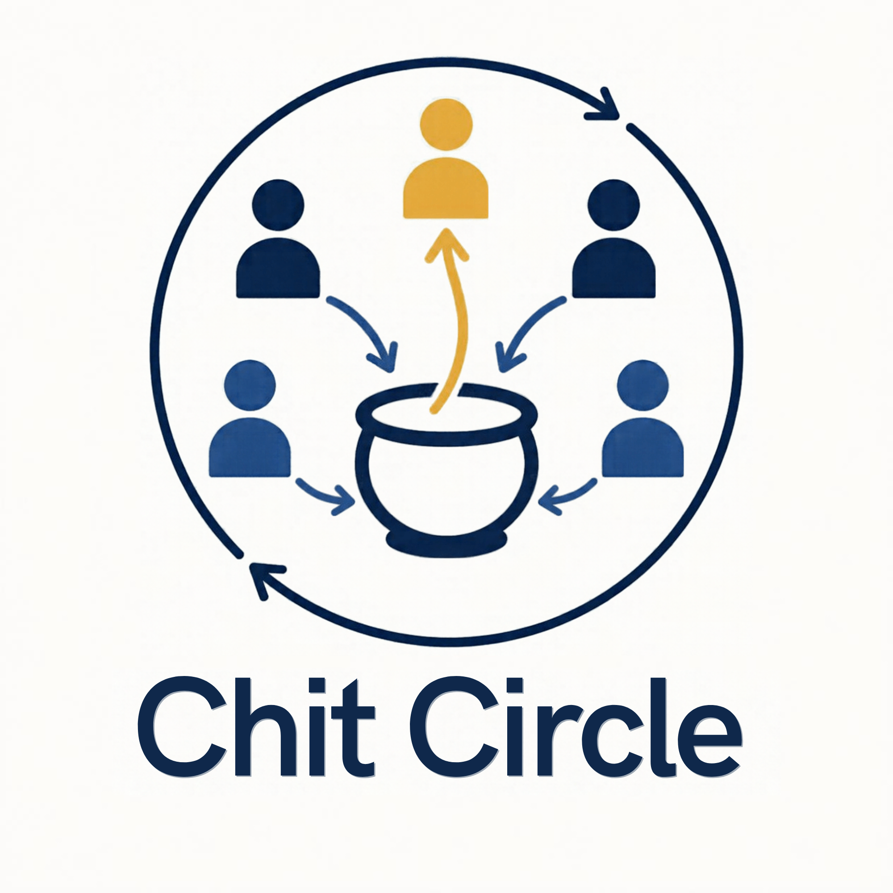

<p align="center">
  
</p>

# Chit Circle

A savings circle you run with people you trust: everyone puts in the same
amount each round, and each round one member receives the whole pot.

Team project for the Monad Metropolis hackathon (Consumer Products & Payments track).

- Submission deadline: October 13, 2026, 11:59 PM ET
- Concept (Chit Circle): [docs/concept.md](docs/concept.md)
- Hackathon brief (bounties, rules, deadlines): [docs/metropolis_hackathon_brief.md](docs/metropolis_hackathon_brief.md)

## Run the App

```sh
npm install
npm start
```

No `.env` is needed: the live Monad testnet deployment is configured in
`sdk/src/config.ts`, so the app reads real circles out of the box.

> **After editing `.env`, bundle with a cleared cache.** Metro inlines
> `EXPO_PUBLIC_*` values at bundle time but does not reliably invalidate its
> cache when they change — a verified failure here was a build picking up a
> *new* `.env` yet still shipping the *previous* value. `npm run export:web`
> always clears; for the dev server use `npm run start:clear` after an `.env`
> change, or passkeys and funding will fail for no visible reason.

`npm start` prints a development-client QR code. **Passkeys need a custom
development build — they do not work in Expo Go**, which cannot load the native
WebAuthn module. `npm run start:go` opens an Expo Go tunnel instead, which is
fine for working on screens but will fail the moment you touch sign-in.
`npm run web` starts the separate browser build.

Agora's official deployment table lists Monad testnet AUSD as
`0xa9012a055bd4e0eDfF8Ce09f960291C09D5322dC`; it is configured already and can
be overridden with `EXPO_PUBLIC_AUSD_ADDRESS`. The AUSD faucet contract is
[`0xd236c18D274E54FAccC3dd9DDA4b27965a73ee6C`](https://testnet.monadscan.com/address/0xd236c18D274E54FAccC3dd9DDA4b27965a73ee6C#code),
and the Send screen links to it for test-money claims — note its 60-second
cooldown is **global to the faucet, not per account**, so a group cannot all
claim at once. Enter a public account address to inspect circles, or create /
unlock a passkey account to submit transactions. Passkey actions additionally
require the domain association described below.

### Configure Mera Passkeys

Mera passkeys always need an HTTPS relying-party hostname the team controls.
There are two ways to reach a real phone from there, and the SDK supports both:
`sdk/src/mera.ts` picks the WebAuthn client by platform, using Mera's built-in
browser client (`navigator.credentials`) when a `document` exists and its
`react-native-passkey` bridge otherwise.

**Browser (no app build).** Serve the web export over HTTPS and open it on the
phone. No association files, no store credentials, no build queue:

```sh
npm run export:web      # writes dist/
npx vercel deploy --prod dist
```

Then set `EXPO_PUBLIC_MERA_RP_ID` to the deployed hostname and export again, so
the bundle knows its own relying party. Note that `expo export` copies
`public/` into `dist/`, so the same deployment can also serve the native
association files below.

**Native development client.** Set `EXPO_PUBLIC_MERA_RP_ID`, the iOS/Android app
IDs, `IOS_TEAM_ID`, and `ANDROID_SHA256_CERT_FINGERPRINTS` in `.env` (Android
fingerprints come from `eas credentials`). Generate the files with
`npm run configure:passkeys` — `docs/assetlinks.template.json` shows the shape —
publish the contents of `public/.well-known/` at `https://<rp-id>/.well-known/`
without redirects, then build and install a development client:

```sh
eas login && eas init           # prints the project ID; set EAS_PROJECT_ID
eas build --profile development --platform android
```

Expo Go cannot load the native passkey module, so run `npm run start:dev`
against the installed client. iOS additionally needs Apple signing credentials,
and its association file must be served as `application/json`.

### Funding new accounts

A passkey account is a plain EOA, so a brand-new one cannot pay the network fee
on its first action. On sign-up the app tops it up from a throwaway account set
in `EXPO_PUBLIC_GAS_FUNDER_KEY`, behind a "Setting up your account…" state.
**This is testnet only: Metro inlines `EXPO_PUBLIC_*` values into the app
bundle, so that key ships inside the installed app and must hold nothing but
testnet MON** — never the deployer key, never anything reused elsewhere. The
production answer is sponsorship (a paymaster, or EIP-7702 delegation to a
sponsoring contract), not a key on the device. Leave the variable blank and the
app runs without funding; `sdk/src/gas.ts` documents the thresholds and the
measured per-circle cost.

The app stores only the passkey credential ID and derived public address in
SecureStore. PRF output, seed, and private-key bytes are not persisted. Clearing
the app metadata and signing in with the same discoverable passkey reconstructs
the same account. The prompt-free contribution cap and contract restriction are
client-side policy; Mera's signing key itself does not enforce those limits.

### ChitCircle on Monad Testnet

ChitCircle is **already deployed and verified** on Monad testnet, and those
values are baked into `sdk/src/config.ts`, so the app runs with no `.env` at
all:

| | |
|---|---|
| ChitCircle | `0x13ec22E7d0BF5b728549990aA852d03BCC9da73D` |
| AUSD (Agora) | `0xa9012a055bd4e0eDfF8Ce09f960291C09D5322dC` (6 decimals) |
| Deploy block | `70523429` |

Source is verified on Sourcify, and the on-chain bytecode was checked against
the local build. The contract has no owner, admin or pause function, so the
deploying account holds no privileges over it. A full lifecycle — create, join,
contribute, settle with deposit seizure, withdraw — has been run against this
live deployment.

The root `.env` is only needed to **override** these (a redeploy) or to set
`EXPO_PUBLIC_MERA_RP_ID` for passkeys; copy `.env.example` and fill in what you
need. Passkey transactions additionally require the relying-party domain files
to be published and the custom development client to be installed — the Expo Go
app will not load the native passkey module, so run `npm run start:dev`.

<details>
<summary>Redeploying (only if the contract changes)</summary>

Use an encrypted Foundry keystore. **Never put a private key in a file or paste
one into chat.**

```sh
cast wallet new deployer          # once; prompts for a password
forge script script/Deploy.s.sol --rpc-url https://testnet-rpc.monad.xyz \
  --broadcast --account deployer \
  --verify --verifier sourcify \
  --verifier-url https://sourcify-api-monad.blockvision.org/
```

`Deploy.s.sol` refuses any chain other than Monad testnet and asserts the AUSD
address has contract code and reports 6 decimals before broadcasting; it never
deploys the local `MockUSD`. Afterwards update `chitCircle` and `deployBlock` in
`sdk/src/config.ts` — take `deployBlock` from the receipt, not an earlier guess,
since circle discovery scans logs from it.

</details>

## Checks

```sh
npm run typecheck
npm run test:sdk
npm run test:sdk:e2e
npm run test:contracts
```

The SDK e2e and contract tests require Foundry (`anvil` and `forge`).

## Implementation Status

- Fixed-order circle contract logic and SDK calls are implemented; local tests
	cover creation, joining, contribution, settlement, default handling, and
	member-to-member transfers.
- The Expo app supports preview mode and configured live Monad testnet reads
	and writes through the SDK.
- Mera passkey account derivation, viem signing, credential metadata storage,
	session expiry, and a client-side contribution scope/cap are implemented.
	Every write re-prompts for the passkey except a contribution within the
	configured cap. The relying-party domain association and native signing build
	still need team-specific identifiers and credentials, and **the passkey
	ceremony has not yet been exercised on a physical device** — everything else
	listed here is covered by the test suites below.
- New accounts are funded on sign-up so their first action can pay the network
	fee, behind a "Setting up your account…" state with a retry. This needs
	`EXPO_PUBLIC_GAS_FUNDER_KEY`; without it the app runs read-only. It is a
	testnet stand-in for sponsorship, not sponsorship — see above.
- The app builds and renders as a web export as well as a native app, which is
	the route to a passkey on a real phone that needs no app build. Which
	WebAuthn client is used is chosen by platform and covered by tests; on web,
	passkey metadata falls back from SecureStore to `localStorage`.
- The ChitCircle contract is deployed and Sourcify-verified on Monad testnet,
	and its address, deploy block and the official AUSD address are configured in
	the SDK, so no `.env` is required to run against the live deployment.
- Bid mode is a stretch goal and intentionally reverts as unimplemented.
- Branding is in place: the app icon, Android adaptive icon, splash and web
	favicon are generated from the team logo in `assets/`.
- Transaction activity indexing, invite landing page/universal links, live
	product deployment, tester results, pitch/demo videos, and hackathon
	submission are external or unfinished deliverables.

## Branches

| Branch | Owner |
|---|---|
| `main` | Shared, merge via pull request |
| `kaushik` | Kaushik |
| `sohan` | Sohan |
| `aadit` | Aadit |
| `rohan` | Rohan |

## Known limitation: what defaulting costs

A member's deposit covers exactly one missed contribution. In a circle of three
or more, a member who misses a payment is locked out of contributing again but
still receives their scheduled payout, so defaulting can leave them ahead while
a member who paid in full absorbs the shortfall.
`contracts/test/DefaultEconomics.t.sol` measures this rather than describing it.

A production version would size the deposit to each member's full remaining
exposure, or forfeit a defaulter's payout. We are shipping the simple version
and saying so.

## Known limitation: how we find your circles

`ChitCircle` keeps no index of "circles this account is in", so the app works it
out: it reads `nextCircleId()` and then asks `isMember(circleId, you)` for each
id — one `eth_call` per circle, no logs involved.

That is **O(circles in the contract)**, not O(circles you are in). It is the
right shape at demo and small-group scale and the wrong shape at a real one:
past a few hundred circles this should read from an index —
[Envio](https://envio.dev) HyperIndex is the Monad-native option — or the
contract should maintain a `circleIdsOf[address]` array and spend the gas. The
`maxCircles` option on `DiscoveryOptions` bounds the work in the meantime.

We did it this way because the obvious approach does not survive contact with
the network. Discovery originally scanned `CircleCreated` and `Joined` logs from
the deploy block. That passes against a local anvil and fails on Monad's public
RPC, which rejects any `eth_getLogs` spanning more than 100 blocks — and the
chain adds roughly 16,000 blocks an hour, so the scan needed over a thousand
chunked requests and grew worse hourly. The deployed app just said "could not
load circles". `sdk/test/discovery.test.ts` and one e2e test now fail if a future
change reintroduces a log scan.

One consequence worth knowing: `createCircle` records no organizer, so a circle
you created but have not yet **joined** is not linked to you on chain. The app
bridges that gap with `DiscoveryOptions.knownIds`, fed from ids remembered on the
device — and every id is still verified against the contract, so local state can
never invent a circle. Once you join, nothing local is needed, which is why
clearing storage and signing in again restores everything.

## External code used

All application code in this repository was written during the hackathon. We
build on these third-party libraries, used as published:

| Library | Used for |
|---|---|
| [`@category-labs/mera`](https://github.com/category-labs/mera) | Passkey (WebAuthn PRF) accounts and signing sessions |
| [`viem`](https://viem.sh) | Typed Ethereum RPC, ABI encoding, wallet clients |
| [`@scure/bip32`, `@scure/bip39`](https://github.com/paulmillr/scure-bip32) | Deterministic key derivation from the passkey PRF output |
| [`@noble/hashes`](https://github.com/paulmillr/noble-hashes) | SHA-256 for bid salts |
| [Foundry](https://getfoundry.sh) (`forge`, `cast`, `anvil`) + `forge-std` | Contract build, tests, deployment, local chain |
| [Expo](https://expo.dev) / [React Native](https://reactnative.dev) | Mobile app shell |
| [`react-native-passkey`](https://github.com/f-23/react-native-passkey) | Native WebAuthn bridge on iOS/Android |
| [`expo-secure-store`](https://docs.expo.dev/versions/latest/sdk/securestore/) | Storing non-secret passkey credential metadata |

External contracts we interact with but do not own: Agora's **AUSD** token and
its faucet on Monad testnet (addresses above).

## AI-tool disclosure

AI tools were used during this project, as permitted by the hackathon rules.

**Anthropic's Claude (via Claude Code)** was used for:

- drafting and reviewing TypeScript in the SDK (including `sdk/src/mera.ts`,
  `gas.ts`, `mock.ts` and their tests), and the Solidity test
  `contracts/test/DefaultEconomics.t.sol`;
- investigating third-party behaviour we then verified on-chain ourselves — the
  AUSD faucet's global cooldown and 6-decimal denomination, and Mera's key
  handling;
- reconciling the team's branches, and writing parts of this README and
  `docs/api.md`.

**Claude, via Canva**, produced the Chit Circle logo artwork in `assets/`. The
app icon, Android adaptive icon, splash and favicon are derived from it.

Every AI-assisted change was reviewed by a team member, and the test suites and
the live-testnet lifecycle run in this repository are our verification of it.
Product direction, architecture and all engineering decisions are the team's
own.

## License

[MIT](LICENSE)
